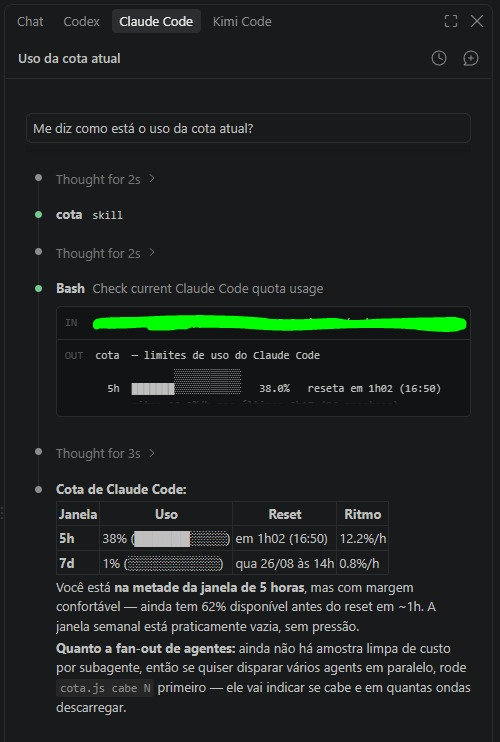

# cota

Deixa o agente do Claude Code saber quanto da sua cota de uso já foi gasto, e
responder a pergunta que interessa antes de disparar trabalho pesado: **a cota
aguenta lançar 10 subagentes em paralelo? E se não, quantos agora?**



Funciona na extensão do VS Code, no terminal e sem interface. Lê a cota pelo
próprio Claude Code, com o mesmo pedido que a extensão do VS Code usa no
medidor de uso dela — sem chamar API da Anthropic por conta própria e sem ler
credencial. As decisões
de projeto, e o porquê de cada uma, estão em [DECISOES.md](DECISOES.md).

## Como funciona

A cota é lida com o próprio Claude Code, pelo protocolo de controle do CLI —
o mesmo que o Agent SDK e a extensão do VS Code usam:

```
claude -p --input-format stream-json --output-format stream-json --verbose
```

com uma única mensagem na entrada:

```json
{"type":"control_request","request_id":"cota","request":{"subtype":"get_usage","skip_behaviors":true}}
```

A resposta traz o percentual e o horário de reset da janela de 5 horas, da
semanal e da semanal de cada modelo — os números do `/usage` — e o plano da
conta. **Não é prompt**: nenhum modelo é chamado e nenhuma cota é gasta.

Cada leitura leva cerca de 1,5 segundo, então ela **só acontece quando alguém
precisa do número** e a última leitura já envelheceu. Não há processo de fundo
nem timer:

| Quem pede | Lê de novo se a leitura tiver mais de |
|---|---|
| o agente ou você rodando `cota` / `cota cabe` | 60s |
| o hook de admissão, antes de lançar subagentes | 60s |
| o primeiro subagente, quando não há medição em curso | 60s |
| um subagente que termina, se o trecho medido já tem 2min ou se é o último | sempre — é o número que vira custo |
| o vigia, quando um subagente termina | 3min, sem esperar outra leitura |
| o aviso, quando você manda mensagem | 10min, sem esperar outra leitura |

Parado, nada roda. Conversando, no máximo uma leitura a cada 10 minutos. Se
uma leitura falha (sem rede, conta sem plano), ninguém tenta de novo por 5
minutos — senão cada mensagem sua esperaria a falha de novo. `cota sondar`
tenta na hora.

Com isso a ferramenta:

- **avisa** quando a janela passa do limiar, de carona na sua mensagem;
- **pergunta antes** de o agente lançar subagentes com a cota alta;
- **mede** o ritmo de um subagente — quanto da janela ele gasta por hora
  rodando — e quanto tempo eles costumam rodar, e com isso responde quantos
  cabem agora;
- **vigia** a cota enquanto um workflow roda.

## Peças

| Arquivo | Papel | Como roda |
|---|---|---|
| `lib/sonda.js` | Lê a cota pelo `get_usage` do CLI. A única fonte do número. | chamada pelos outros |
| `cota.js` | O leitor: janelas, ritmo, admissão, diagnóstico. | você / o agente |
| `hooks/aviso.js` | Avisa quando a cota passa do limiar. | hook `UserPromptSubmit` |
| `hooks/admissao.js` | Pergunta antes de operação pesada com a cota alta. | hook `PreToolUse` |
| `hooks/medidor.js` | Mede o custo de cada subagente, em trechos, e vigia. | hooks `SubagentStart` / `SubagentStop` / `SessionEnd` |
| `skill/SKILL.modelo.md` | Ensina o agente a usar. O instalador gera o literal. | skill |
| `instalar.js` | Liga tudo nesta máquina, **confere** que ligou, e desfaz. | `node instalar.js` |
| `run.ps1` | Invólucro do Windows para os hooks. | os hooks |
| `cota.cmd` / `cota` | Atalho de linha de comando: Windows / Linux e macOS. | você |
| `teste.js` | Teste de ponta a ponta, com um claude falso. | `node teste.js` |

O estado fica em `~/.claude/cota/` — nada é gravado dentro do repositório.

## Requisitos

- **Claude Code** — a extensão do VS Code ou o CLI.
- **Plano Claude.ai Pro ou Max.** Em conta de API avulsa não existe cota de
  plano para ler.
- **Node.js 18 ou mais novo.** Não precisa estar no PATH: o instalador grava o
  caminho do node com que você rodar ele.

## Instalar

```bash
node instalar.js
```

O script:

1. grava `node-local.txt` com o caminho deste node (fica fora do git);
2. gera `~/.claude/skills/cota/SKILL.md` com o comando literal desta máquina;
3. acrescenta os cinco hooks em `~/.claude/settings.json`, preservando o que já
   estiver lá e guardando o original em `settings.json.bak-cota`;
4. **executa** o que acabou de gerar — inclusive uma leitura de verdade da
   cota — e só declara sucesso se tudo responder.

É idempotente: rodar de novo não duplica nada, e corrige o que mudou —
inclusive se você mover a pasta do projeto: os hooks são reconhecidos pelo
script que chamam, não pela pasta, e passam a apontar para o lugar novo.

Depois **abra uma sessão nova** — hooks e skills são lidos na inicialização.

Para testar antes, sem encostar no seu estado real nem gastar cota:

```bash
node teste.js
```

## Desinstalar

```bash
node instalar.js --remover
```

Tira só o que é do cota: os hooks dele e a skill. Hooks de outras ferramentas
ficam intactos, e o settings.json de antes da remoção fica em
`settings.json.bak-cota-remover`. O histórico em `~/.claude/cota/` fica — apague
a pasta se quiser.

## Instalar na mão

O instalador não faz mágica — são três passos. Trocando `<PASTA>` pela pasta
deste projeto e `<NODE>` pelo caminho do seu node:

**1. `~/.claude/settings.json`** — os cinco hooks.

> **Some, não substitua.** Se o arquivo já existe, acrescente estas chaves ao
> que está lá. Colar o bloco por cima apaga suas permissões, modelo e tema.

No Windows, o comando é sempre `powershell ... -File <PASTA>/run.ps1 <script>`:

```json
{
  "hooks": {
    "UserPromptSubmit": [
      { "hooks": [{ "type": "command", "command": "powershell -NoProfile -ExecutionPolicy Bypass -File <PASTA>/run.ps1 hooks/aviso.js" }] }
    ],
    "PreToolUse": [
      { "matcher": "Agent|Task|Workflow",
        "hooks": [{ "type": "command", "command": "powershell -NoProfile -ExecutionPolicy Bypass -File <PASTA>/run.ps1 hooks/admissao.js" }] }
    ],
    "SubagentStart": [
      { "hooks": [{ "type": "command", "command": "powershell -NoProfile -ExecutionPolicy Bypass -File <PASTA>/run.ps1 hooks/medidor.js" }] }
    ],
    "SubagentStop": [
      { "hooks": [{ "type": "command", "command": "powershell -NoProfile -ExecutionPolicy Bypass -File <PASTA>/run.ps1 hooks/medidor.js" }] }
    ],
    "SessionEnd": [
      { "hooks": [{ "type": "command", "command": "powershell -NoProfile -ExecutionPolicy Bypass -File <PASTA>/run.ps1 hooks/medidor.js" }] }
    ]
  }
}
```

No Linux e no macOS, troque cada `command` por `"<NODE>" "<PASTA>/<script>"`.

Caminho com espaço vai **entre aspas duplas** — no JSON, `\"...\"` — senão o
comando falha calado.

**2. A skill.** Copie `skill/SKILL.modelo.md` para
`~/.claude/skills/cota/SKILL.md` e troque os `{{COTA}}` por
`<NODE> <PASTA>/cota.js`, com barra normal nos dois caminhos (o agente roda
isso pelo Bash, onde a barra invertida é escape) e entre aspas se houver espaço.

**3. Abra uma sessão nova.**

### Por que existe um `run.ps1` no Windows

Porque os dois jeitos óbvios falham, cada um num shell, e **os dois falham
calados**:

| Comando | Falha porque |
|---|---|
| `C:\...\node.exe C:\...\aviso.js` | o `cmd.exe` lê o `/c` de `/claude-limits` como switch dele |
| `C:\...\aviso.cmd` | o bash come as barras invertidas como escape |

O formato documentado da Anthropic é imune aos dois: executável com nome simples
que está no PATH (`powershell`) e caminho como argumento.

## Usar

O agente usa sozinho, pela skill. Na mão: `cota.cmd` no Windows, `./cota` no
Linux e no macOS, ou `node cota.js` em qualquer um.

```bash
cota                     # as duas janelas, o semanal por modelo, e o ritmo da última hora
cota cabe 10             # a cota aguenta 10 subagentes? quantos agora?
cota cabe 10 Explore     # idem, usando a média desse tipo de agente
cota sondar              # lê a cota agora, ignorando o cache
cota audit               # diagnóstico: em que elo a corrente quebrou
cota off | cota on       # desliga / religa a ferramenta inteira
cota config              # mostra a configuração
cota config aviso.limiar_5h 70
cota limpar              # poda histórico velho (ou: cota limpar 7 → mais de 7 dias)
```

O comando é tolerante de propósito: aceita sinônimo (`ver`, `aguenta`,
`debug`), ignora acento e caixa, entende número solto (`cota 10` = `cota cabe
10`), e comando desconhecido mostra a situação em vez de dar erro. **Digitação
nunca vira código de erro** — se der erro, é problema de verdade.

## Configuração

`~/.claude/cota/config.json`, mudável por comando, vale na próxima chamada.

| Chave | Padrão | O quê |
|---|---|---|
| `ligado` | `true` | Chave geral. Desligada, nada lê, avisa nem mede. |
| `idade_max_s` | `900` | Leitura mais velha que isso (a sonda falhando) passa a valer como piso. |
| `aviso.limiar_5h` | `80` | % da janela de 5h para começar a avisar. |
| `aviso.limiar_7d` | `70` | Mais baixo de propósito: estourar a semanal custa dias. |
| `aviso.repetir_min` | `30` | Intervalo mínimo entre avisos iguais. |
| `admissao.perguntar_acima_de` | `75` | % a partir do qual o `PreToolUse` pergunta. |
| `admissao.margem` | `0.7` | Só autoriza se couber em 70% do que resta. |
| `vigia.limiar_5h` | `70` | % a partir do qual o vigia fala no fim de cada subagente. |
| `vigia.repetir_min` | `5` | Curto: durante workflow a cota anda rápido. |
| `medidor.orfao_max_s` | `172800` | Subagente em voo é órfão quando a sessão dele fechou ou morreu; esta idade (48h) só decide quando o Claude Code não diz. |
| `medidor.trecho_s` | `120` | Quem termina só lê a cota se o trecho medido já tem isso; senão a parte dele sai no próximo marco. |
| `poda.dias` | `14` | Histórico mais velho que isso sai. |
| `poda.max_linhas` | `5000` | Teto de linhas nos arquivos de amostra. |
| `sonda.idade_s` | `60` | Idade a partir da qual o `cota`, a admissão e a abertura de onda leem de novo. |
| `sonda.vigia_s` | `180` | Idem para o vigia. |
| `sonda.aviso_s` | `600` | Idem para o aviso — alto porque ele atrasa a sua mensagem. |

## O que sai da sua máquina

O código deste projeto não fala com rede e não lê credencial. Mas cada leitura
abre uma sessão do `claude` oficial, e **essa sessão fala com a Anthropic**,
com o login que o Claude Code já tem: consulta o uso do seu plano e o que mais
o Claude Code envia ao iniciar. Em uso ativo isso acontece até uma vez por
minuto; parado, nunca.

A sessão da leitura roda isolada: sem gravar conversa, sem hooks, sem
servidores MCP, sem as configurações do projeto em que você está, e dentro de
`~/.claude/cota/`.

## De onde vem o `claude`

A cada leitura, nesta ordem: `$COTA_CLAUDE`, o PATH (só entradas absolutas),
`~/.local/bin`, e o binário embutido na extensão do VS Code. No Windows só vale
`.exe`.

A pasta da extensão **muda a cada atualização** (`anthropic.claude-code-2.1.299-…`
vira `…-2.1.300-…`), e a velha fica no disco até o VS Code limpar. Por isso o
caminho nunca é gravado: cada leitura procura de novo pela versão que o VS Code
registra como instalada, ignorando as obsoletas. Se um candidato nem executar,
vai o próximo. Quando o executável muda, o `cota sondar` avisa:
`mudou de extensão 2.1.299 há 5min, achado sozinho`.

## Limitações

- **A leitura se apoia num pedido não documentado.** O `get_usage` é o que a
  extensão do VS Code usa no medidor dela, mas não está na documentação, e o
  método do SDK que o envia se chama
  `usage_EXPERIMENTAL_MAY_CHANGE_DO_NOT_RELY_ON_THIS_API_YET`. Se mudar, a
  ferramenta para e diz qual elo quebrou — nunca inventa número. Se sumir, o
  plano B é voltar ao `/usage` como prompt; a receita está no
  [DECISOES.md](DECISOES.md), D39.
- **A Anthropic publica percentual e horário de reset, não o limite em número
  absoluto.** E o percentual vem inteiro: uma onda curta que custou 0,4% mede 0.
- **Não há projeção de consumo, de propósito.** O uso real é por rajadas, e
  nenhuma média entre os regimes descreve qualquer um deles. O ritmo mostrado é
  medição da última hora, não previsão.
- **O ritmo por subagente é divisão, não atribuição.** O que a cota sobe num
  trecho é dividido pelas horas de subagente rodando nele — de todas as
  sessões, porque os hooks são globais. Subagentes no mesmo trecho saem com o
  mesmo ritmo: um Opus pesado ao lado de um Haiku leve não se distinguem ali.
  A conversa principal das sessões também entra na conta e infla o ritmo — o
  lado seguro.
- **Agente longo atravessa janelas.** Um subagente de 12h gasta de três
  janelas de 5h. O `cabe` conta, na janela de 5h, só o tempo até o reset; a
  semanal paga a duração inteira, e para trabalho longo é ela que manda.
- **O sub-limite semanal por modelo é mostrado, mas não decide:** a admissão
  usa só a janela de 5h e a semanal geral.
- **Relógio da máquina torto = countdown mentiroso.** O `audit` desconfia.
- **Promoções mudam o denominador:** com o limite temporariamente maior, o
  percentual de hoje não é comparável com o de depois.

## Plataformas

O núcleo é Node puro, sem dependência. O que muda por plataforma é o invólucro
dos hooks, e o instalador escreve o certo.

> **Aviso honesto:** o projeto nasceu e é usado no Windows. O suporte a Linux e
> macOS foi escrito e a geração de comando é testada, mas **nunca rodou nessas
> plataformas**. Se for o primeiro, rode `node teste.js` antes e abra uma issue
> se algo não bater.

## Segurança

Sem `eval`, sem `new Function`, sem `require` dinâmico, sem shell. O único
processo externo é o `claude` oficial, chamado com argumentos em lista. O estado
é gravado com permissão `0600`. O que foi sondado e corrigido está em
[DECISOES.md](DECISOES.md), seção "Segurança".

## A verdade é o `/usage`

Os números são os mesmos do `/usage`, lidos do próprio Claude Code. O que
pode errar é o resto — o custo por
agente, a admissão, as ondas. Na dúvida, o `/usage` da extensão ou do terminal
é a referência.

## Licença

[MIT](LICENSE).
